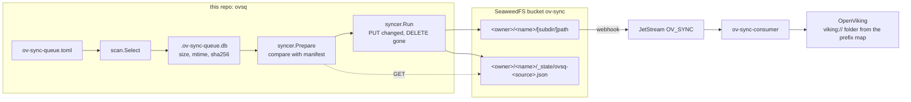

# ov-sync-queue: a local folder into the ov-sync bucket

## The path a file takes

Everything right of the bucket lives in JasperHG90/localstack. ovsq's job ends
when the object and its manifest entry are in the bucket
([ADR 0002](../decisions/0002-ov-sync-queue-syncs-into-the-ov-sync-bucket-not-straight-to-the-queue.md)).

## One run

1. `config.Load` reads the TOML over defaults, applies `OVSQ_<SECTION>__<KEY>`
   overrides and refuses a prefix that is not `<owner>/<name>`.
2. `scan.Select` walks the include folders (or `git ls-files` with
   `git_tracked_only`) and drops excluded folders, globs, wrong extensions,
   `_state/` and ovsq's own two files.
3. `syncer.Prepare` reads the manifest (missing means empty), hashes each file
   unless the cache's size and mtime match, and sorts files into upload,
   unchanged and skipped (over 16 MiB). Manifest entries with no selected file
   become deletes.
4. `syncer.Run` uploads in batches of 100, eight at a time, recording the hash
   of the bytes it actually sent, and writes the manifest after every full
   batch. With `--delete` it then removes gone keys. It writes the manifest
   once more if anything changed, then saves the cache. If the scan selected
   nothing while the manifest lists files, it refuses `--delete`. Manifest
   writes ignore Ctrl-C, so finished uploads stay recorded.
5. `ovsq status` stops after step 3 and opens the cache read-only, so it never
   writes.

## Invariants

| Must stay true | Enforced by |
|---|---|
| The manifest only ever records what is in the bucket | `TestRunFailuresKeepManifestTrue` |
| Nothing is deleted without `--delete` | `TestRunDelete` |
| An empty scan (wrong or symlinked folder) never deletes the prefix | `TestDeleteSafety`, `TestSelection` |
| A cancelled run still records finished uploads | `TestManifestWriteSurvivesCancel` |
| `manifest.json`, the CI action's file, is never written | `TestRunUploadsAndWritesManifest` |
| A lost cache costs no upload | `TestRunUnchangedUploadsNothing` |
| `status` writes nothing | `TestStatusWritesNothing` |
| No multipart upload; files over 16 MiB are skipped | `TestRunSkipsLargeFiles`, `TestS3Store` |

`packages/ov-sync-queue/e2e/run.sh` runs the binary against a real SeaweedFS
with a no-list identity. It needs docker and is not a gate.

## Depicts

- Entry point: `packages/ov-sync-queue/main.go` (`ovsq init`, `status`, `run`, `version`)
- Modules: `internal/config`, `internal/scan`, `internal/state`,
  `internal/syncer`, `internal/s3store` under `packages/ov-sync-queue/`
- Invariants: the table above
